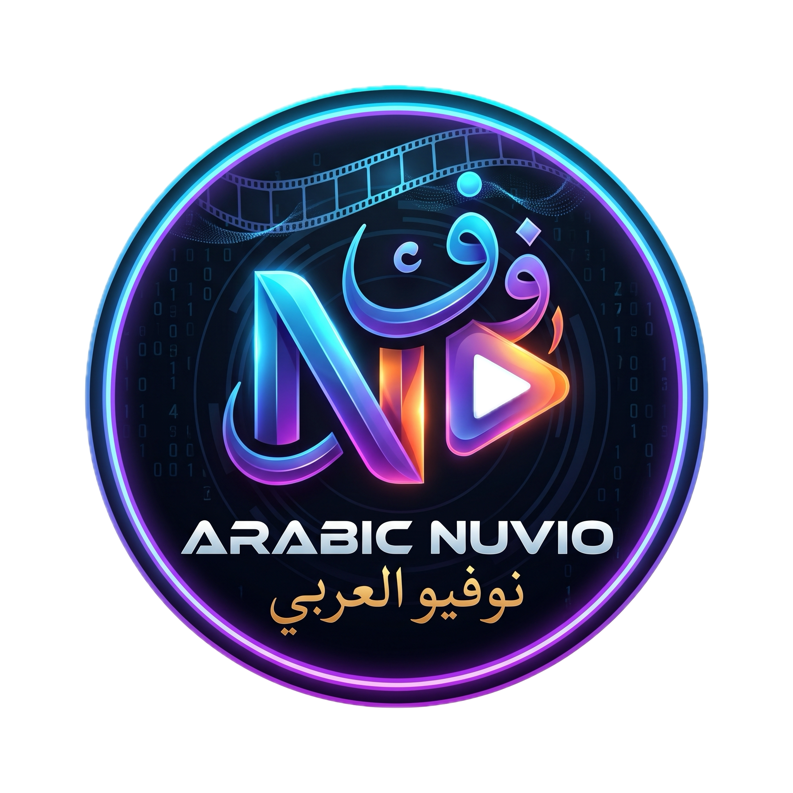

# Arabic Nuvio — Providers, Catalog Addon & Collections

<p align="center">
  
</p>

Official **Arabic Streaming Providers**, **IMDb-Linked Catalog Addon**, and **Collections** for **[Nuvio](https://nuvio.tv)** (`NuvioTV` & `NuvioMobile`).

The architecture separates **content discovery** (Catalog Add-on with standardized `tt...` IMDb IDs and Cinemeta metadata/posters) from **stream playback** (56 JS Stream Providers matched by `imdbId` and `imdbId:season:episode`).

---

## 🔗 Quick Setup Links for Nuvio

Copy and paste the following URLs directly into the **Nuvio** app:

### 1. Streaming Providers (Nuvio JS Plugins — 56 Sequenced Providers)
Provides direct multi-quality MP4 and HLS streams (`240p` up to `4K 2160p`) with Arabic and English subtitles across 56 prioritized Arabic, Turkish, Asian, Hindi/English, anime, and live sports providers (including **Shabakaty Cinemana**, **CEE**, and 13 additional **Arabic Cinema Hub** providers).

- **In Nuvio:** Go to **Settings → Plugins → Add Repository**
- **Repository URL:**
```text
https://raw.githubusercontent.com/SafaaSalam/Arabic-Nuvio/main/manifest.json
```

---

### 2. Catalog & Metadata Addon (IMDb-Linked)
Adds **30 catalogs** to your Nuvio home screen with standardized **IMDb IDs (`tt...`)**, high-resolution Cinemeta posters/backdrops, and `imdbId:season:episode` matching:
- **6 Global Discovery Rows:** *Latest Additions (All Sources)*, *Trending Now / Popular Today*, *Latest Movies*, *Latest Series*, *New Episodes Today / Recently Updated*, and *Top 10 This Week*.
- **Per-Source Rows:** Dedicated *Latest Movies* and *Latest Series* rows for integrated sources (**Cee** and **Cinemana** are hidden from the home page and kept strictly as playback providers in the Stream Plugin).

- **In Nuvio:** Go to **Addons → Add Addon**
- **Addon URL:**
```text
https://raw.githubusercontent.com/SafaaSalam/Arabic-Nuvio/main/addon/manifest.json
```

---

### 3. Curated Collections (English Titles)
Imports pre-configured, priority-sequenced collections and folders with official posters and backdrops.

- **In Nuvio:** Go to **Collections → Import → From URL**
- **Collections URL:**
```text
https://raw.githubusercontent.com/SafaaSalam/Arabic-Nuvio/main/nuvio-collections.json
```

---

### 4. External Repository Bridge (Optional for NuvioTV)
For **NuvioTV** external plugin support:

```text
https://raw.githubusercontent.com/SafaaSalam/Arabic-Nuvio/main/repo.json
```

---

## 🏆 Priority-Sequenced Providers (`56` Providers)

### Top 5 Priority Providers
| Priority | Provider | ID | Supported Types | Quality / Features |
| :---: | :--- | :--- | :--- | :--- |
| **1** | **Shabakaty Cinemana (🇮🇶)** | `cinemana` | Movies, TV Series, Anime | Up to `4K (2160p)` MP4 + Arabic/English Subtitles |
| **2** | **CEE (🇮🇶)** | `cee` | Movies, TV Series, Anime | Direct Multi-Quality MP4 + Arabic/English Subtitles |
| **3** | **3isk \| قصة عشق** | `3isk` | Turkish TV Series & Movies | Direct HLS `.m3u8` & Multi-Server Embeds |
| **4** | **AlooyTv** | `alooytv` | Gulf, Arabic & Turkish Series | Direct `1080p`/`720p` MP4 Streams |
| **5** | **Akwam \| أكوام** | `akwam` | Movies, TV Series, Shows | Direct Multi-Quality MP4 (`1080p` / `720p` / `480p`) |

### Arabic Movies, Series & Drama Providers (`6–28`)
| # | Provider | ID | Category |
| :---: | :--- | :--- | :--- |
| 6 | **FaselHD \| فاصل إعلاني** | `faselhd` | Movies, TV Series, Asian Drama & Anime |
| 7 | **MyCima \| ماي سيما** | `mycima` | Movies & TV Series |
| 8 | **Shahid4U \| شاهد فور يو** | `shahid4u` | Movies & TV Series |
| 9 | **TopCinema \| توب سينما** | `topcinema` | Movies & TV Series |
| 10 | **WeCima \| وي سيما** | `wecima` | Movies & TV Series |
| 11 | **EgyDead \| ايجي ديد** | `egydead` | Movies & TV Series |
| 12 | **EgyBest \| ايجي بست** | `egy` | Movies & TV Series |
| 13 | **TukTukcima \| توك توك سيما** | `tuktukcima` | Movies & TV Series |
| 14 | **CimaClub \| سيما كلوب** | `cimaclub` | Movies & TV Series |
| 15 | **CimaLight \| سيما لايت** | `cimalight` | Movies, Turkish & Asian Series |
| 16 | **CimaTN \| سيما تونس** | `cimatn` | Movies & TV Series |
| 17 | **LodyNet \| لودي نت** | `lodynet` | Turkish, Indian & Asian Series |
| 18 | **Krmzy \| قرمزي** | `krmzy` | Turkish Series |
| 19 | **Eseek \| عشق** | `eseek` | Turkish Series |
| 20 | **Asia2TV \| آسيا تو تي في** | `aia2tv` | Korean, Japanese & Chinese Drama |
| 21 | **5TV** | `5tv` | Movies & TV Series |
| 22 | **Aflaam \| أفلام** | `aflaam` | Arabic Movies & Series |
| 23 | **OscarTV \| أوسكار تي في** | `oscartv` | Arabic & Turkish Series |
| 24 | **Viu** | `viu` | Arabic, Turkish & Asian Series |
| 25 | **ShahidWBas \| شاهد وبس** | `shahidwbas` | Arabic & Ramadan Series |
| 26 | **TuniFlix** | `tuniflix` | Movies & TV Series |
| 27 | **TuniFlix Blog** | `tuniflexblog` | Movies & TV Series |
| 28 | **Elif \| إليف** | `elif` | Turkish Series |

### Arabic Anime & Cartoon Providers (`29–37`)
| # | Provider | ID | Category |
| :---: | :--- | :--- | :--- |
| 29 | **Anime3rb \| أنمي عرب** | `anim3rb` | Subtitled Anime Series & Movies |
| 30 | **Anime4Up \| أنمي فور أب** | `anime4up` | Subtitled Anime Series & Movies |
| 31 | **Animerco \| أنميركو** | `animerco` | Anime Series & Movies |
| 32 | **AnimeWitcher \| أنمي ويتشر** | `animewitcher` | Anime Series & Movies |
| 33 | **WitAnime \| ويت أنمي** | `witanime` | Anime Series & Movies |
| 34 | **Anime Phoenix \| أنمي فينيكس** | `anime-phoenix` | Anime Series & Movies |
| 35 | **AnimeRift \| أنمي ريفت** | `animerift` | Anime Series & Movies |
| 36 | **II1I (Bristege)** | `bristege` | Dubbed & Subtitled Cartoons & Series |
| 37 | **DimaToon \| ديما تون** | `dima-toon` | Arabic Cartoons |

### Live TV, Sports & Video Providers (`38–42`)
| # | Provider | ID | Category |
| :---: | :--- | :--- | :--- |
| 40 | **FullMatchShows** | `replaymatch` | Full Football Match Replays & Shows |
| 42 | **YouTube** | `youtube` | YouTube Streams & Trailers |

### Hindi, English & Arabic Cinema Hub Providers (`40–56`)
| Provider | ID | Category |
| :--- | :--- | :--- |
| **Moviesmod** | `moviesmod` | Hindi & English Movies & Series |
| **VegaMovies** | `vegamovies` | Hindi & English Movies & Series |
| **Bollyflix** | `bollyflix` | Bollywood & Hollywood Movies & Series |
| **MoviesDrive** | `moviesdrive` | High Quality Movies & TV Shows |
| **CVN-CimaNow** | `cimanow` | Arabic Movies & Series |
| **CVN-AflamStream** | `aflamstream` | Translated Movies |
| **CVN-QFilm** | `qfilm` | Movies & Series |
| **CVN-EGYBET** | `egybet` | Movies & Series |
| **CVN-TukCima** | `tukcima` | Movies & Series |
| **CVN-FasselHD** | `fasselhd` | Movies & Series |
| **CVN-FaselHD** | `faselhd2` | Alternative FaselHD Source |
| **CVN-EgyDead CA** | `egydeadca` | Alternative EgyDead Domain |
| **CVN-QDrama** | `qdrama` | Drama Series |
| **CVN-MySeed** | `myseed` | Movies & Series |
| **CVN-AhwakTV** | `ahwaktv` | TV Series |
| **CVN-Starzplay** | `starzplay` | Movies & Series |
| **CVN-FlixMomo** | `flixmomo` | Movies & Series |

---

## 🗂️ Curated Collections (`nuvio-collections.json`)

20 prioritized collections (30 folders) pinned with **Latest — All Sources** (Global Discovery Rows: *Latest Additions*, *Trending Now*, *Latest Movies*, *Latest Series*, *New Episodes Today*, and *Top 10 This Week*), followed by per-source *Latest Movies* / *Latest Series* collections. (**Cinemana** and **CEE** are omitted from home catalogs/collections and operate as stream-only providers.)

---

## 🛠️ Development & Auto-Sync

Catalogs and collections are synchronized automatically **every 15 minutes** via GitHub Actions ([`.github/workflows/auto-update.yml`](.github/workflows/auto-update.yml)). GitHub may delay scheduled runs by a few minutes under load.

**How a sync works**

- Every source row keeps its full history in `data/store/<row>.json`, ordered **newest → oldest**. Each run re-reads the first pages of the source (new releases go to the top) and back-fills a few older pages (resuming where it stopped) until the whole back-catalog is loaded. Items are never dropped when a source's front page moves on.
- Rows are published in pages of 100 (`addon/catalog/<type>/<row>.json`, then `addon/catalog/<type>/<row>/skip=100.json`, …), so Nuvio keeps loading older posters as you scroll — there is no item limit.
- Duplicates are removed inside every row by id, IMDb id and normalised title (episode/“مترجم”/“مسلسل” decorations are ignored). The two **Latest — All Sources** rows mix the newest items of every source and are de-duplicated across sources.
- Files are only rewritten when their content changes, so a quiet 15 minutes produces no commit.
- `data/health.json` lists every row with its item count, whether the source was reachable on the last run, and the date it last succeeded. A source that is down simply keeps its last good data.
- **Sources that block GitHub's servers** (shown with `reachable: false` in `data/health.json`; currently Cinemana, CEE and several anime/Cloudflare sites) only update when the sync runs from a normal home connection. Install a [self-hosted runner](https://docs.github.com/actions/hosting-your-own-runners) on a PC that stays on, then set the repository variable `SYNC_RUNNER` to `self-hosted` — the same workflow then runs there every 15 minutes.
- Cinemana only answers from Iraqi (Earthlink) networks. On GitHub it keeps using its captured data; run `npm run sync` from an Iraqi connection and push to refresh it live.

To run or test locally (requires Node.js 18+):

```bash
# Sync latest catalogs, metadata, and collections (and mirror to GitHub directory)
npm run sync

# Run automated verification and stream tests
npm test

# Offline unit tests (merge, de-duplication, paging) and structural check of the generated catalogs
npm run test:store
npm run verify

# Episode-list extraction and provider stream-lookup tests
node scripts/test-episodes.js && node scripts/test-episode-streams.js

# Start local CORS development server (http://localhost:3000)
npm run serve
```
